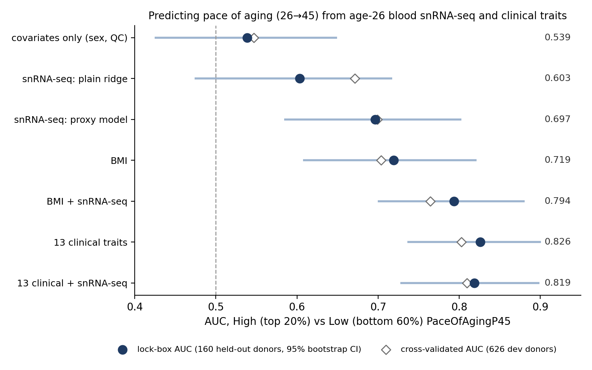

# Overnight search: predicting PaceOfAgingP45 from snRNA-seq (started 2026-09-24 22:40)

Working folder: `/home/nlapique/Blood/script/NIGHT_PaceOfAging_snRNA/`
(`scripts/` = code, `data/` = cached donor-level matrices, `results/results.csv` = one line per experiment,
`results/oof/` = out-of-fold predictions, `results/*.log` = console logs).
If the machine crashes, everything up to the last finished experiment is in `results/results.csv`.

## ▶ SUMMARY (final, 2026-09-25 ~01:00)

**Question:** how well does age-26 blood snRNA-seq predict PaceOfAgingP45 (High = top 20% vs Low = bottom 60%),
alone and combined with age-26 clinical traits?  ~90 pipelines were compared by cross-validation on 626 dev donors;
the pre-declared final models were then scored **once** on 160 locked-away donors (`scripts/final_lockbox.py`).

| model (trained on 626 dev donors) | CV AUC | **lock-box AUC** [95% CI] | lock-box Spearman ρ |
|---|---|---|---|
| covariates only (sex, n cells, UMI, % mt) | 0.547 | 0.539 [0.43–0.65] | 0.03 |
| snRNA-seq, plain ridge on pseudobulk | 0.671 | 0.603 [0.47–0.72] | 0.11 |
| **snRNA-seq only, proxy model** | 0.699 | **0.697 [0.58–0.80]** | **0.29 (p < 0.001)** |
| BMI only | 0.704 | 0.719 [0.61–0.82] | 0.33 |
| **BMI + snRNA-seq (proxy model)** | 0.764 | **0.794 [0.70–0.88]** | 0.44 |
| 13 age-26 clinical traits | 0.803 | 0.826 [0.74–0.90] | 0.52 |
| 13 clinical + snRNA-seq | 0.809 | 0.819 [0.73–0.90] | 0.51 |

Lock-box paired differences (bootstrap): snRNA-only vs covariates **+0.158 [0.03, 0.28], p = 0.01**;
BMI + snRNA vs BMI **+0.075 [−0.02, 0.18], p = 0.06** (CV: +0.061, p = 0.049); clinical + snRNA vs clinical −0.007.

**Conclusions**
1. **snRNA-seq alone predicts pace of aging:** AUC ≈ 0.70, replicated on held-out donors (CV 0.699 → lock-box 0.697).
2. **The best snRNA model is the "proxy model"** (`meta_models.ProxyModel`): library-corrected all-cells pseudobulk
   (full transcriptome, 11.8k genes) → ridge predictions of 18 age-26 traits (13 clinical + 5 blood counts, used only
   as *training labels*) + a direct pace prediction → second-level ridge. A new donor needs only snRNA-seq.
   The plain ridge looked almost as good in CV (0.671) but fell to 0.603 on the lock-box: the proxy model is the robust one.
3. **What snRNA-seq "sees" is mostly the smoking axis.** It predicts smoking (ρ 0.55), VO2max (0.70), CRP/WBC (~0.45)
   but not BMI (0.14). Once smoking history is measured, snRNA-seq adds nothing. Removing the `cal` component
   from pace (`POA45_nocal`; likely periodontal clinical attachment loss, a smoking-driven component) drops snRNA AUC
   from 0.66 to 0.57, far more than removing any other component (section 12).
4. **Best framing for a paper emphasizing snRNA-seq:** "BMI + a blood sample" reaches 0.79, close to the
   13-trait clinical panel (0.83), which needs lipids, glucose, CRP, VO2max testing, blood pressure and a smoking interview.
   snRNA-seq effectively replaces most of the clinical panel except BMI.
5. **Things that did not help** (all CV): per-cell-type pseudobulk or ensembles, composition / Leiden clusters,
   detection rates, cell-to-cell variability, curated literature gene sets, XGBoost / SVR / kernel methods / PLS,
   classifiers trained on the extremes, rank targets, sex-specific models, 26→45 slopes or age-45 values as
   training labels, blends of model families. Everything plateaus at ~0.69–0.70 with snRNA alone.

**Caveats**
- The lock-box has 32 High vs 96 Low donors, so its CIs are wide (±0.1).
- `cal` = periodontal attachment loss is my reading of the column name; check it with the Dunedin data dictionary.
- The curated gene sets were written from memory, not downloaded.
- Library correction uses library mean profiles from the training donors. A new donor must come from those libraries, or be corrected against its own library's mean.

**Files**
- `results/LOCKBOX_*.csv`: final numbers and per-donor predictions. `results/results.csv`: all CV experiments.
- `results/final_models_all786.pkl`: the snRNA-only and BMI + snRNA proxy models refit on all 786 donors (see `note` inside).
- `scripts/`: `prep*.py` (caches), `evalkit.py` (CV and features), `meta_models.py` (proxy model), `exp01–12`, `final_*.py`.

**Suggested next steps**
- Check the periodontal/smoking interpretation: correlate snRNA-predicted pace with CAL at 26/32 directly, if available.
- Smoking adjustment: done in section 14. A modest signal survives (AUC 0.61, p = 0.02).
- For a biology section: the genes with the largest weights in the direct snRNA→pace ridge, and the trait-proxy weights of the second level.

---

## Setup (fixed before any experiment)

- **Donors:** 786 with PaceOfAgingP45 and snRNA-seq.
- **Lock-box:** 160 donors (20%, stratified by pace decile, seed 2026, `data/lockbox.csv`) are held out and only
  used once at the very end on the final few models. Everything else uses the 626 **dev** donors.
  Reason: trying many pipelines and keeping the best inflates its CV score; the lock-box gives an unbiased number.
- **CV:** 5-fold × 3 repeats on dev donors, same folds for every experiment. All feature selection, scaling,
  imputation and hyper-parameter tuning happen inside each training fold.
- **Main metric:** AUC for High (top 20%) vs Low (bottom 60%) pace, cutoffs from each training fold
  (= `quantile_low=0.6`, `quantile_high=0.8` in the notebook). Also Spearman ρ on all test donors and R².
- **Only age-26 predictors:** snRNA-seq (blood drawn at 26) and age-26 clinical traits. Nothing from 32/38/45.
- **Data:** raw counts of the full transcriptome (29,572 genes) from the CellBender h5ad, summed per donor ×
  `CellType` (+ all cells), cached in `data/` by `scripts/prep.py` (30 s).

## Results log

### 1. Baselines (`scripts/exp01_baselines.py`)

| experiment | AUC | Spearman | R² |
|---|---|---|---|
| covariates only (sex, log n cells, log UMI, % mt) | 0.547 | 0.09 | −0.01 |
| **age-26 clinical (13 traits) + cov, ridge** | **0.803** | 0.47 | 0.24 |
| clinical without smoking | 0.762 | 0.41 | 0.18 |
| smoking only (current + pack-years) | 0.677 | 0.26 | 0.08 |
| clinical + blood counts + DNAm cell fractions | 0.791 | 0.47 | 0.24 |
| cell-type composition (CLR) | 0.580 | 0.16 | 0.01 |
| Leiden cluster composition | 0.55–0.56 | 0.12–0.14 | 0.00 |
| **all-cells pseudobulk, full transcriptome (8356 genes), ridge** | **0.638** | 0.24 | 0.02 |
| same, PCA-50 / PLS-3 / top-500 screen | 0.59 / 0.62 / 0.61 | | |

Per-fold AUC SD is ~0.05, so differences below ~0.02 are noise.

### 2. Pseudobulk variants (`exp02`)
- **Gene expression filter:** a looser filter is better. Mean CPM ≥ 3 (11.7k genes) → **0.663**; ≥1 → 0.651; ≥10 → 0.638; ≥100 → 0.638.
- **Single cell types:** CD4 Active 0.632, B Memory 0.603, Naive T 0.596, Classical Mono 0.595, B Naive 0.592. CD8 Active (0.505) and NK (0.499) are at chance.
- **Detection rate** (fraction of cells expressing) instead of log-CPM: 0.610.
- **All cell types concatenated:** 0.60–0.63, which dilutes the signal relative to the all-cells pseudobulk.

### 3. snRNA-seq → predicted clinical traits → pace ("proxy model", `exp03`, `meta_models.ProxyModel`)
Age-26 clinical traits are used **only as training labels**. snRNA-seq learns to predict each trait, and a
second-level ridge combines the predicted traits (+ a direct snRNA→pace prediction). A new donor needs **only snRNA-seq**.
All inner fits use training-fold donors only (inner 5-fold out-of-fold predictions feed the second level).

How well snRNA-seq predicts each age-26 trait (Spearman, 5-fold CV, all-cells pseudobulk; `results/snRNA_predicts_traits.csv`):
VO2max **0.70**, current smoking **0.55**, DNAm NK fraction 0.55, CD8 naive 0.50, B cells 0.48, pack-years 0.47,
CRP 0.45, WBC 0.44, urea 0.41, HbA1c 0.39, HDL 0.34 … **BMI only 0.14**, cholesterol 0.06.
BMI is the strongest single clinical predictor of pace and is almost invisible in blood nuclei.

| experiment | AUC | ρ |
|---|---|---|
| direct ridge (reference) | 0.663 | 0.26 |
| proxy[13 clinical] + direct | **0.685** | 0.30 |
| proxy[31: clinical + blood counts + DNAm cell fractions] + direct | 0.676 | 0.28 |
| per-cell-type ensembles (8 cell types + composition; mean / stacked / 5 main types) | 0.629 / 0.620 / 0.641 | |

### 4. Batch correction and donor weighting (`exp04`)
- **Library correction** (per donor × library log-CPM minus the library mean, from dev donors only, then averaged per donor): neutral on its own (0.662–0.664).
- **Weighting training donors by cell count:** small consistent gain (√n 0.671, log 0.669, cap 300 0.670, drop <100 cells 0.667).
- **Proxy model on library-corrected pseudobulk: 0.695 ± 0.073, the best snRNA-only model so far.**

### 5. Curated gene sets and combined models (`exp05`)
- **Literature gene panels** (smoking, Peters 2015 aging up/down, IFN, inflammation, senescence, metabolic) × 8 cell types: 0.50–0.61. Genome-wide models do better.
- **Clinical + snRNA-seq proxies (stacked): 0.803**, the same as clinical alone (0.803). snRNA-seq still adds nothing on top of measured clinical traits.

### 6. Learners / transforms (`exp06`, partial)
Rank-transformed target 0.658, quantile-normal genes 0.650, logistic on extremes 0.640, top-20%-vs-rest 0.623:
none beat plain ridge on continuous pace.

### 7. Future variables as training-only labels (`exp07`, partial)
The 26→45 component slopes as proxy labels: 0.641, worse than age-26 traits as labels. Age-26 expression predicts the slopes too poorly.

### 6b. More learners (`exp06`, complete)
PLS-10 components **0.676** (PLS-2/5: 0.55/0.63), XGBoost on the top 300 genes 0.644, supervised screening + ridge
(2000/5000 genes) 0.60, linear SVR 0.59, RBF kernel ridge 0.55. Ridge on all genes remains the best simple learner.

### 7b. Future variables as training-only labels (`exp07`, complete)
Proxy labels: age-45 values 0.677; clinical-26 + slopes 0.679; + age-45 0.680; + the 19 POA45_no* 0.679; slopes alone 0.641.
None beat age-26 clinical labels alone (0.685 on plain pseudobulk, 0.695 on library-corrected).

### 8. Minimal clinical + snRNA-seq (`exp08`) (the most useful framing so far)
| measured at 26 | clinical alone | + snRNA-seq proxy model | ΔAUC (paired, corrected p) |
|---|---|---|---|
| BMI only | 0.704 | **0.764** | **+0.061 (p = 0.049)** |
| BMI + HDL | 0.726 | 0.774 | +0.048 (p = 0.09) |
| BMI + smoking | 0.789 | 0.788 | 0 |
| BMI + smoking + HDL | 0.795 | 0.794 | 0 |
| BMI + smoking + blood pressure | 0.788 | 0.788 | 0 |
| all 13 traits | 0.803 | 0.809 (direct stack) | +0.007 (p = 0.38) |

**Interpretation:** the snRNA-seq signal for pace is mostly the **smoking** signal (plus some fitness/inflammation).
With BMI alone, snRNA-seq adds a significant +0.06 AUC. Once smoking history is measured, it adds nothing.
snRNA-seq alone vs covariates: +0.148 AUC (p = 0.001).

### 9. Proxy-model refinements (`exp09`)
13 clinical + 5 blood-count labels **0.699**; bagged ×5 0.698; 9 pace-related labels 0.697; √n weighting 0.694;
CPM ≥ 1 0.692; adding CD4 Active pseudobulk 0.687. Plateau.

### 10. Blends and sex-specific models (`exp10`)
Separate models per sex 0.664 (worse: half the data per model); PLS-10/15 on library-corrected 0.669/0.644; composition
celltype + Leiden 0.562; blends of proxy + PLS + ridge 0.697, proxy + XGBoost 0.692, 4 proxy variants 0.699.

### 11. Cell-level moments (`exp11`, `prep4`)
Mean of log1p(CP10k) per donor (all cells 0.635; CD4 / naive T / B naive 0.59–0.61) and within-donor cell-to-cell
variance (0.57–0.63); proxy model on these 0.656–0.659. Worse than the log of summed counts.

### 12. Which pace components does snRNA-seq see? (`exp12`, `results/targets_component_removal.csv`)
snRNA-seq (library-corrected ridge) AUC for pace and the 19 leave-one-component-out versions: 0.65–0.68 for all
except **POA45_nocal 0.573** (and POA45_norcor 0.649). Clinical AUC drops less (0.803 → 0.761).

### 13. Lock-box (`final_lockbox.py`, run once), see SUMMARY above.

### 14. Does snRNA-seq predict pace beyond smoking? (`exp13`, CV on dev donors)
- **Smoking measured, with vs without snRNA-seq:** smoking only (current + pack-years) 0.677 → smoking + snRNA proxy 0.710 (+0.032, p = 0.12).
- **Pace with smoking regressed out:** snRNA proxy **0.610 (vs 0.5: p = 0.02)**, snRNA ridge 0.580.
So a modest snRNA signal remains beyond smoking. The largest part of snRNA-seq's predictive power is smoking-related.

Largest standardized weights of the direct snRNA→pace ridge (all dev donors; `results/top_genes_direct_ridge.csv`):
JAK3 (+), **CPT1A (+)**, **TERF2 (−)**, DMGDH (+), CDK11A (+), NEDD4L (+), MIAT (+), **PLIN2 (+)**, LPCAT3 (+), CD38 (−), HPGD (+) …
Ridge spreads weight across thousands of genes, so single genes are weakly determined. Lipid metabolism (CPT1A, PLIN2,
LPCAT3) and telomere maintenance (TERF2, lower in faster agers) are suggestive leads, not findings.

### 15. Other cutoffs: control = bottom 70%, case = top 10% (`scripts/rescore_cutoffs.py 0.7 0.9`, 2026-09-25)
Same fitted models, re-scored only (no refitting, no new selection). Cutoffs come from training / dev donors.

| model | CV AUC (626 dev, ~13 cases per fold) | lock-box AUC (16 cases vs 112 controls) [95% CI] |
|---|---|---|
| covariates only | 0.549 | 0.583 [0.42–0.74] |
| **snRNA-seq only (proxy)** | **0.736** | 0.640 [0.49–0.78] |
| BMI only | 0.676 | 0.722 [0.57–0.85] |
| BMI + snRNA-seq | 0.789 | 0.725 [0.57–0.86] |
| 13 clinical | 0.846 | 0.787 [0.67–0.90] |
| 13 clinical + snRNA-seq | 0.857 | 0.793 [0.67–0.91] |

- **snRNA vs covariates:** CV +0.187 (p = 0.0002), lock-box +0.057 (p = 0.25).
- **BMI + snRNA vs BMI:** CV +0.113 (p = 0.016), lock-box +0.004.

With only 16 cases the lock-box can't confirm or refute the CV gain; its CIs span ±0.15.
The CV numbers are more precise but slightly optimistic, because the model was chosen under the 60/80 cutoffs on these donors.

### 16. sc-ImmuAging pretrained clocks (`prep5_scimmuaging.py`, `exp14_scimmuaging.py`, 2026-09-29)
Li et al. (Nat Aging 2025) LASSO clocks for CD4T/CD8T/MONO/NK/B, applied to log1p(CP10k) of the full transcriptome
(82–98% of |coef| mass mapped from Ensembl to our hg19 symbols). The donor mean profile is used instead of random pseudocells
(same expectation, because the clock is linear). Library-corrected like the pseudobulk. "Naive T cells" are split into CD8 (CD8A/CD8B > 0) and CD4.
- **The clocks capture immune aging biology:** CD4T/CD8T scores track the DNAm naive CD8 fraction (ρ −0.39 / −0.31) and naive CD4
  (−0.25 / −0.27), CRP (+0.19) and VO2max (−0.21), and the T-cell clocks correlate with each other (0.40). Absolute ages are off (MONO ≈ −2, CD8T ≈ 64),
  which is expected for nuclei vs PBMC whole cells.
- **They do not predict pace:** best univariate ρ = +0.07 (CD4T, p ≈ 0.06–0.09); 5 clocks + cov AUC 0.52–0.55 (covariates alone 0.547);
  proxy + clocks 0.684 vs 0.699 (worse, p = 0.03); smoking + clocks 0.654 vs 0.677; smoking-residualized pace 0.518. The result is the same at min_cells 1/5/20.

### 17. Is the snRNA signal stronger in Low HDL / Low CRP donors? (post hoc, existing OOF predictions, 2026-09-29)
A single model fit on all dev donors (Y02 proxy, OOF), scored within tertiles with global 60/80 cutoffs (no refitting).
- **HDL:** proxy AUC Low 0.68 / Medium 0.72 / High 0.64 (CIs overlap). **The smoking-only model** shows the gradient (0.73 / 0.63 / 0.58), and
  pace–pack-years ρ is 0.42 / 0.24 / 0.11. Low HDL is also 73% male and has 59 fast agers (vs 26 in High). So the Low-HDL advantage in the
  per-tertile sweeps looks like "where smoking drives pace + more cases", not an snRNA-specific effect.
- **CRP:** proxy AUC Low 0.76 / Medium 0.67 / High 0.64, while smoking-only is flat (0.67 / 0.67 / 0.65) and clinical-13 is *lowest* in Low CRP (0.77).
  The gradient is in both sexes (M 0.79→0.65, F 0.73→0.64), so it is not only sex composition. Low − High = +0.12, 95% CI [−0.01, 0.25];
  beyond the smoking-model gradient, CI [−0.02, 0.22]. Borderline, and chosen after many tertile looks, so it is a hypothesis, not a finding.
  The proxy model is also better in men overall (0.74 vs 0.65).

### 18. v11 scVI-XGB trained once on all dev donors, scored within HDL / CRP tertiles (`exp15_scvi_v11_tertiles.py`, 2026-09-29)
Features: scVI-denoised expression (model_scvi_adata_reduced_epochs_300_with_sex, library 1e4) averaged per donor and cell type,
top 1000 genes by mean count. Model: v11 stability selection (50 XGB) + final XGB. Same 5x3 folds; High = top 10%, Low = bottom 60% (v11).
- Overall per cell type 0.51–0.64 (B Memory best at 0.64); 9-cell-type rank ensemble 0.59. Rescored at 0.6/0.9: proxy Y02 0.749, smoking-only 0.761, clinical-13 0.859, cov 0.549.
- HDL Low/Med/High: scVI ensemble 0.59/0.64/0.48 (+0.11, CI −0.12..0.35); smoking-only 0.81/0.71/0.63 (+0.17); proxy 0.75/0.76/0.72.
- CRP: scVI ensemble 0.59/0.55/0.55 (+0.04), so **the sweep's Low-CRP advantage is not reproduced by a single scVI model**; proxy 0.86/0.79/0.66
  (+0.20, CI 0.07..0.34); smoking-only 0.81/0.77/0.68 (+0.13). Table: `results/exp15_tertile_auc_q60-90.csv`.

### 19. Cell-level MIL models (`/home/nlapique/Blood/script/MIL_PaceOfAging/`, 2026-09-29)
All use the per-cell scVI latent (30 dims), the same 5x3 folds, High = top 10% / Low = bottom 60%, trained on the fold's extremes,
with an inner 15% validation split for early stopping. Official code in `repos/` (MixMIL, ScRAT, scMILD, CloudPred; a one-line sklearn fix in CloudPred).
| model | AUC |
|---|---|
| mean-pooled latent (+ per-cell-type means) + L2 logistic | 0.669 ± 0.065 |
| ABMIL (gated attention) | 0.657 ± 0.094 |
| MixMIL | 0.625 ± 0.065 |
| scMILD | 0.598 ± 0.069 |
| ScRAT | 0.585 ± 0.093 |
| CloudPred | 0.526 ± 0.117 |
| (reference) snRNA proxy model | 0.749 |
None beats the simple mean-pool, and all are far below the proxy model.
